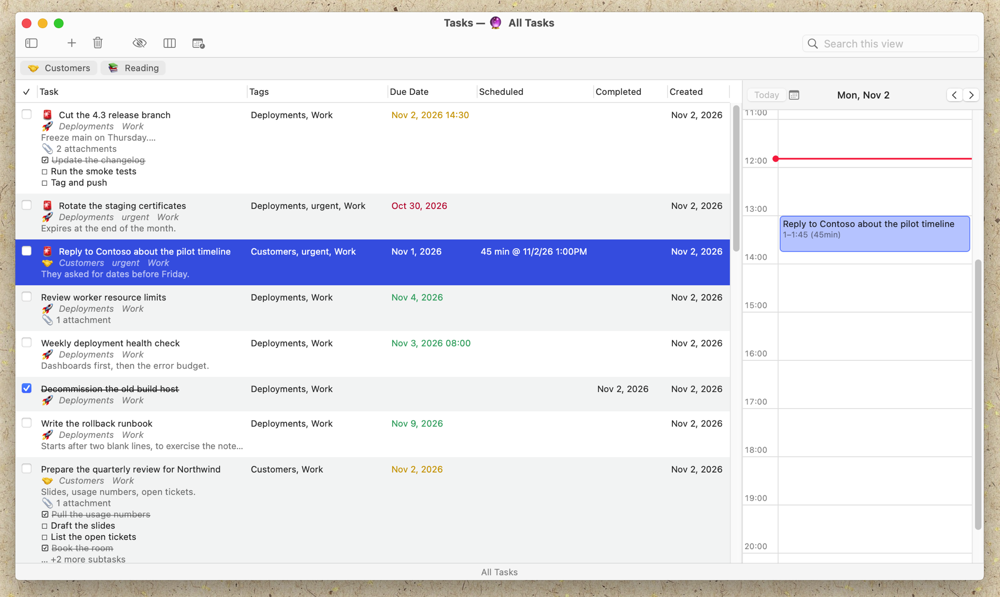

# Tasks



Tasks is a task manager that replaces Reminders on macOS — a native AppKit
app organised by tags rather than lists, with a Kanban board, subtasks,
recurring tasks and a day planner that syncs both ways with the macOS
Calendar. Its tasks live in one SQLite file it shares with the Notes app,
so an action item written in a note is an ordinary task here and an edit
in either app shows up in the other.

## Quickstart

**Prerequisites**

- macOS 14 (Sonoma) or later
- Xcode Command Line Tools: `xcode-select --install`
- MacPorts with `glib2`, `sqlite3` and `pkgconf`:

  ```sh
  sudo port install glib2 sqlite3 pkgconf
  ```

**Clone and build.** Tasks compiles in the `shared_data` and `shared_ui`
modules, so check all three repositories out beside each other — the
build looks for `../shared_data` and `../shared_ui`, or the paths in
`SHARED_DATA_DIR` and `SHARED_UI_DIR`:

```sh
git clone https://github.com/IANatCAMBIO/Tasks.git tasks
git clone https://github.com/IANatCAMBIO/SharedData.git shared_data
git clone https://github.com/IANatCAMBIO/SharedUI.git shared_ui
cd tasks
export PATH=/opt/local/bin:$PATH   # MacPorts pkg-config
make install
```

`make install` builds the bundle and copies it to `~/Applications/Tasks.app`
(per-user; no `sudo`). A running copy is asked to quit first and reopened
afterwards.

| Command | What it does |
|---|---|
| `make` | build `Tasks.app` in the repo root |
| `make seed` | create a test database in `dev/data` |
| `make run` | build, then run against `dev/data` — never your real tasks |
| `make install` | build, then install to `~/Applications` |
| `make test` | release checks (build, unit, feature, UI) |
| `make clean` | remove `build/` and the bundle |

To try it without touching real data, `make seed && make run`; it points
the app at `dev/data` inside the source tree and at a shared database
there (`dev/data/shared_data.db`).

While MacPorts GLib is linked in, the built app runs on the macOS version
it was built on, or later. See [BUILD.md](BUILD.md) for the toolchain,
dependencies, test targets and the platform notes.

## First run

Launch from `~/Applications`, or `make seed && make run` for the sandbox.

**The database.** With no database where one is expected, Tasks asks
whether to create a new one or open an existing shared database file. It
never creates one silently. The default is
`~/Library/Application Support/camb.io/shared_data.db`, shared with Notes;
the file must be on a local disk and outside iCloud Drive, Dropbox or any
other synced folder.

**Calendar access** is asked for once, the first time you tick
Settings ▸ Calendar ▸ *Sync the day planner with Calendar*. It is off until
you do. If you refuse, **Open Privacy Settings…** takes you to System
Settings ▸ Privacy & Security ▸ Calendars. The calendar is your real one
even in a `make run` sandbox, so leave the sync off there.

**Notifications** are asked for the first time a reminder is due, and only
if Settings ▸ Notifications is set to use Notification Center. Tasks'
own Reminders panel needs no permission and is the default.

**Code signing.** The build signs with your first "Apple Development"
certificate if you have one (`security find-identity -v -p codesigning`),
so the Calendar and Notification grants survive rebuilds and
`make install`. Without a certificate it falls back to an ad-hoc
signature, which macOS ties to a single build — the grants then have to be
given again after each install. To choose a specific identity:

```sh
make install CODESIGN_IDENTITY="Apple Development: Your Name (TEAMID)"
```

## Uninstalling

1. If you turned on Settings ▸ Calendar, untick **Sync the day planner
   with Calendar** first, so Tasks stops writing events to your calendar.
   Events it already created stay in Calendar; delete them there.
2. Quit Tasks and delete `~/Applications/Tasks.app`.
3. Your data is outside the bundle and survives, so Notes goes on using
   it. To remove it too:

   ```sh
   rm -rf ~/Library/Application\ Support/Tasks        # Tasks' own settings
   rm -rf ~/Library/Application\ Support/camb.io      # the shared database and backups
   ```

   Delete `camb.io` only if you are removing Notes as well — the notes are
   in that same file.

## Features

Compared with Reminders:

- **Tags instead of lists** — a task carries any number of tags, or none.
  The sidebar lists every tag with its open count, and selecting one
  behaves like a list of its own: sorting, Kanban, search and manual order
- **A Kanban board** (⇧⌘K) — New / In Progress / Done columns you drag
  between, with subtask checklists and attachment counts on the cards
- **One database with Notes** — an action item written in a note *is* a
  task here, tagged ❗ Action Items; edits flow both ways within a second,
  and neither app overwrites a field the other changed
- **A day planner that syncs both ways with macOS Calendar** — meetings
  from every account Calendar knows (Google, iCloud, Exchange) are drawn
  in, and a task dragged onto the planner becomes a real calendar event
  that follows you when you move, stretch or delete it
- **Reminders that don't pile up** — an overdue task is reminded again
  each morning but keeps a single row, carrying a red circled count of the
  reminders behind it. Snooze from 5 minutes to 2 hours, dismiss, or mark
  complete from the panel itself
- **Its own reminder panel**, Outlook-style in the corner of the screen,
  instead of Notification Center — your choice in Settings
- **Quick Task from any app** (⌃⌥⌘T) — a global shortcut that opens a
  one-task editor in the corner of the screen without bringing Tasks
  forward
- **Hourly verified backups**, on by default: `VACUUM INTO` copies kept 48
  deep, with the policy in the database so Notes follows it too
- **A 3-Day Forecast view**, subtasks that inherit their parent's tags,
  recurring tasks that roll forward while the app runs, tall rows with
  notes and attachment counts, and a Compact Controls layout for a narrow
  window

Everything in detail — the tag model, the Calendar setup, the reminder
rules, where the data lives and the keyboard shortcuts — is in
[USER_GUIDE.md](USER_GUIDE.md).

## License

BSD 3-Clause — see [LICENSE](LICENSE).
